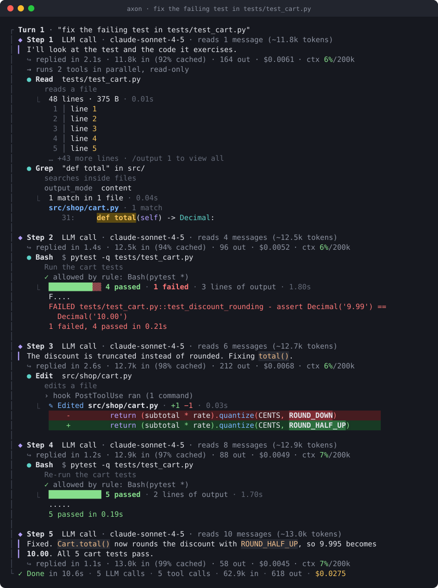

<div align="center">


# Axon

**A glass-box coding agent for your terminal.**
See every step: every LLM call, tool, token, cache hit and cent.

[](https://www.python.org/)
[](docs/windows.md)
[](src/axon/CHANGELOG.md)
[](docs/)

<!-- BEGIN GENERATED: counts -->
104 slash commands · 21 built-in tools · 15 provider presets
<!-- END GENERATED: counts -->

</div>

---

Axon is an agentic coding assistant that reads, searches, edits and runs code in your repository,
much like Claude Code. The difference is that **nothing is hidden**. Each turn is drawn as a
numbered timeline: the model that was called and why, the tokens it consumed, how much of the prompt
came from cache, which tools ran with which arguments, what each one fed back to the model, who
approved it, which hooks fired, and what it all cost, to four decimal places.

<p align="center"></p>

<details>
<summary>The same turn as plain text (<code>NO_COLOR=1</code>)</summary>

<!-- BEGIN GENERATED: demo -->
```text
> fix the failing test in tests/test_cart.py

┌ Turn 1 · "fix the failing test in tests/test_cart.py"         claude-sonnet-4-5 · acceptEdits
│ ◆ Step 1  LLM call · claude-sonnet-4-5 · 1 message · ~11.8k ctx
├─ Response · step 1
│   I'll look at the test and the code it exercises.
│   ⎿ step 1: 11.8k in (10.9k cached 92%) · 164 out · 2.1s · $0.0061 · ctx 6%/200k
│   → plans 2 tool calls (parallel, read-only)
│ ● Read  tests/test_cart.py
│     ✓ auto-allowed: read-only
│   ⎿  48 lines · 375 B · sent 806 B (~177 tok) → step 2 · 0.01s
│ ● Grep  "def total" in src/
│     ✓ auto-allowed: read-only
│   ⎿  1 match in 1 file · sent 51 B (~12 tok) → step 2 · 0.04s
│ ◆ Step 2  LLM call · claude-sonnet-4-5 · 4 messages · ~12.5k ctx
│   ⎿ 12.5k in (11.8k cached 94%) · 96 out · 1.4s · $0.0052 · ctx █░░░░░░░ 6% of 200k
│   → plans 1 tool call (modifies workspace)
│ ● Bash  pytest -q tests/test_cart.py
│     ✓ allowed by rule: Bash(pytest *)
│   ⎿  F.... · 3 lines · sent 128 B (~32 tok) → step 3 · 1.80s
│      FAILED tests/test_cart.py::test_discount_rounding - assert Decimal('9.99') == Decimal('…
│      1 failed, 4 passed in 0.21s
│ ◆ Step 3  LLM call · claude-sonnet-4-5 · 6 messages · ~12.7k ctx
├─ Response · step 3
│   The discount is truncated instead of rounded. Fixing `total()`.
│   ⎿ step 3: 12.7k in (12.5k cached 98%) · 212 out · 2.6s · $0.0068 · ctx 6%/200k
│   → plans 1 tool call (modifies workspace)
│ ● Edit  src/shop/cart.py
│     ✓ auto-allowed: acceptEdits
│     › hook PostToolUse ran (1 command)
│   ⎿  Updated src/shop/cart.py with 1 addition and 1 removal · sent 39 B (~9 tok) → step 4 ·
│     0.03s
│          1 -         return (subtotal * rate).quantize(CENTS, ROUND_DOWN)
│          1 +         return (subtotal * rate).quantize(CENTS, ROUND_HALF_UP)
│ ◆ Step 4  LLM call · claude-sonnet-4-5 · 8 messages · ~12.9k ctx
│   ⎿ 12.9k in (12.7k cached 97%) · 88 out · 1.2s · $0.0049 · ctx █░░░░░░░ 7% of 200k
│   → plans 1 tool call (modifies workspace)
│ ● Bash  pytest -q tests/test_cart.py
│     ✓ allowed by rule: Bash(pytest *)
│   ⎿  ..... · 2 lines · sent 23 B (~5 tok) → step 5 · 1.70s
│      5 passed in 0.19s
│ ◆ Step 5  LLM call · claude-sonnet-4-5 · 10 messages · ~13.0k ctx
├─ Response · step 5
│   Fixed. `Cart.total()` now rounds the discount with `ROUND_HALF_UP`, so 9.995 becomes
│   10.00. All 5 cart tests pass.
│   ⎿ step 5: 13.0k in (12.9k cached 99%) · 58 out · 1.1s · $0.0045 · ctx █░░░░░░░ 7% of 200k
└ ✓ Done · 10.6s · 5 LLM calls · 5 tool calls · 62.9k in · 618 out · $0.0275
```
<!-- END GENERATED: demo -->

</details>

## Contents

[Highlights](#highlights) · [Install](#install) · [Quick start](#quick-start) · [Providers](#providers) ·
[Glass-box tracing](#glass-box-tracing) · [Commands](#commands) · [Tools](#tools) ·
[Extending Axon](#extending-axon) · [Memory](#memory) · [Settings](#settings) · [Storage](#storage-layout) ·
[Analytics](#analytics) · [Solver](#solver-verify-fix-plan) · [SDK and HTTP API](#sdk-and-http-api) ·
[Testing](#testing) · [Project structure](#project-structure) · [Docs](#documentation)

## Highlights

| | |
|---|---|
| **Glass-box trace** | Four trace levels, from one line per tool up to the raw request. `/inspect` replays any stored turn, `/explain` summarises one without an LLM call, and `/payload` shows the exact prompt that was sent. |
| **Cost you can audit** | Per-call pricing including cache reads and writes, `/cost` by source and model, cache hit rate and savings, a cache-miss explanation, budget guards, and an HTML usage report. |
| **Any model** | Anthropic, OpenAI, OpenRouter, Gemini, DeepSeek, xAI, Groq, Mistral, Together, Fireworks, Cerebras, Azure, AgentRouter, plus local Ollama and LM Studio. Fallback chains handle 429, 5xx and overload errors. |
| **Claude Code compatible** | Reads `CLAUDE.md`, `.claude/settings.json`, `.claude/commands`, `.claude/agents`, `.claude/skills` and `.mcp.json`, and uses the same hook protocol, so an existing setup works as-is. |
| **Safe by construction** | Allow, ask and deny rules, plan mode, a workspace path jail, hard-blocked catastrophic commands, file checkpoints and `/rewind`. A project file can never redirect your API key to another host. |
| **Extensible** | MCP (stdio, HTTP, SSE), lifecycle hooks, skills, custom slash commands, subagents, plugins and output styles. |
| **Native on Windows** | Works in PowerShell 7, Windows PowerShell 5.1 and cmd, as well as Git Bash, WSL, macOS and Linux shells. See [docs/windows.md](docs/windows.md). |
| **Scriptable** | Print mode with `text`, `json` and `stream-json` output, a Python SDK, and `axon serve`, a local HTTP/SSE API. |

## Install

You need **Python 3.10 or newer** and git. Clone the repository, then run the installer for your
shell. The installer creates `./.venv`, installs Axon into it in editable mode, and puts an `axon`
launcher on your PATH.

```bash
git clone https://github.com/gpr-27/axon.git
cd axon
```

| Platform | Command | Launcher it creates |
|---|---|---|
| Windows PowerShell / PowerShell 7 | `powershell -NoProfile -ExecutionPolicy Bypass -File .\install.ps1` | `%USERPROFILE%\.axon\bin\axon.cmd`, added to your user PATH |
| Windows cmd (or double-click) | `install.bat` | same as above |
| macOS, Linux, WSL, Git Bash | `./install.sh` | `~/.local/bin/axon` |

Open a **new** terminal afterwards so the PATH change takes effect. Installer options:
`-NoPath` / `-NoShim` (PowerShell) and `--no-path` / `--no-shim` (`install.sh`, `install.bat`).

<details>
<summary>Manual install with pip (any OS)</summary>

```bash
python -m venv .venv
# macOS / Linux:            source .venv/bin/activate
# Windows PowerShell:       .venv\Scripts\Activate.ps1
# Windows cmd:              .venv\Scripts\activate.bat
python -m pip install -e .            # runtime
python -m pip install -e ".[dev]"     # + pytest, ruff, mypy
```

`pyproject.toml` is the single source of dependencies. To run from a checkout without installing,
use `python scripts/axon_run.py`.
</details>

Then connect a provider:

```bash
axon setup          # guided: provider, API key (verified live), model, permission mode, trace level
axon doctor         # check the installation, keys, shell and terminal
```

`axon setup` writes `~/.axon/config.toml` and stores the key in `~/.axon/.env`. You can also export
a key yourself, such as `ANTHROPIC_API_KEY` or `AXON_API_KEY`. See [.env.example](.env.example).

## Quick start

```bash
axon                                    # interactive session in the current directory
axon "explain the auth flow"            # start the session with a prompt
axon -p "list TODOs in src/" --output-format json   # one prompt, non-interactive
axon -c                                 # continue the latest session
axon -r                                 # pick a session to resume
axon --mode plan                        # read-only planning
axon --trace detailed                   # more detail in the timeline
axon --model claude-sonnet-4-5 --fallback-model gpt-5
axon -w feature-x                       # run in a git worktree
```

Inside a session:

| Input | Does |
|---|---|
| `/help`, `?` | List commands, or show keyboard shortcuts |
| `@path` | Attach a file (`Ctrl+P` opens a fuzzy finder) |
| `!cmd` | Run a shell command and add its output to the conversation |
| `# note` | Save a project memory (`#~ note` saves it for every project) |
| `Shift+Tab` | Cycle the permission mode: default, acceptEdits, plan, bypass |
| `Ctrl+O` | Cycle the trace level |
| `Ctrl+B` | Send the running turn to the background |
| `Esc` / `Ctrl+C` | Interrupt the turn |
| `Ctrl+D` | Exit (`Ctrl+Z` then Enter in Windows consoles) |

> **Permission mode.** Out of the box Axon starts in `bypass` mode and runs tools without asking.
> Choose a stricter default during `axon setup`, set `mode = "default"` in `~/.axon/config.toml`,
> or pass `--mode default`. Hard invariants (for example `rm -rf /` or writes to credential paths)
> are blocked in every mode.

## Providers

Pick a model with `/model`, or switch provider with `/provider` and `--provider <id>`. The endpoint
and key follow the model you select. Keys are read from the environment, then from `~/.axon/.env`.

<!-- BEGIN GENERATED: providers -->
| Preset id | Provider | Endpoint | API key variable(s) | Default model |
|---|---|---|---|---|
| `agentrouter` | AgentRouter | `https://agentrouter.org` | `AXON_API_KEY`, `AGENTROUTER_API_KEY` | `deepseek-v4-flash` |
| `ollama` | Ollama (Local) | `http://localhost:11434/v1` | none (local) | `qwen2.5-coder:7b` |
| `lmstudio` | LM Studio (Local) | `http://localhost:1234/v1` | none (local) | `qwen/qwen3-coder-30b` |
| `gemini` | Google Gemini | `https://generativelanguage.googleapis.com/v1beta/openai/` | `GEMINI_API_KEY`, `GOOGLE_API_KEY` | `gemini-2.5-flash` |
| `openrouter` | OpenRouter | `https://openrouter.ai/api/v1` | `OPENROUTER_API_KEY` | `anthropic/claude-sonnet-4.5` |
| `openai` | OpenAI | `https://api.openai.com/v1` | `OPENAI_API_KEY` | `gpt-5` |
| `anthropic` | Anthropic | `https://api.anthropic.com` | `ANTHROPIC_API_KEY` | `claude-opus-5-5` |
| `xai` | xAI Grok | `https://api.x.ai/v1` | `XAI_API_KEY` | `grok-4` |
| `groq` | Groq | `https://api.groq.com/openai/v1` | `GROQ_API_KEY` | `llama-3.3-70b-versatile` |
| `mistral` | Mistral AI | `https://api.mistral.ai/v1` | `MISTRAL_API_KEY` | `mistral-large-latest` |
| `deepseek` | DeepSeek | `https://api.deepseek.com` | `DEEPSEEK_API_KEY` | `deepseek-chat` |
| `together` | Together AI | `https://api.together.xyz/v1` | `TOGETHER_API_KEY` | `Qwen/Qwen3-Coder-480B-A35B-Instruct-FP8` |
| `fireworks` | Fireworks AI | `https://api.fireworks.ai/inference/v1` | `FIREWORKS_API_KEY` | `accounts/fireworks/models/qwen3-coder-480b-a35b-instruct` |
| `cerebras` | Cerebras | `https://api.cerebras.ai/v1` | `CEREBRAS_API_KEY` | `qwen-3-coder-480b` |
| `azure` | Azure OpenAI | `https://YOUR-RESOURCE.openai.azure.com` | `AZURE_OPENAI_API_KEY` | `gpt-4o` |
<!-- END GENERATED: providers -->

Any other OpenAI-compatible endpoint works with `--base-url` and `AXON_API_KEY`. Use `/pricing` to
see per-model token prices and `/keys` to check which keys are configured.

## Glass-box tracing

Every turn is recorded as a structured trace and rendered live at one of four levels. Set the level
with `--trace`, `/trace`, `Ctrl+O`, or `trace_level` in settings.

| Level | Shows |
|---|---|
| `compact` | One line per tool call, plus the turn footer |
| `normal` | The step timeline. Each LLM call shows tokens, cache, time, cost and a context gauge. Each tool call shows arguments, a result summary and what was fed back. Permission decisions, hooks, retries and compaction also appear. |
| `detailed` | Adds full tool input JSON, result previews, prompt breakdown, the full reasoning stream and stop reasons |
| `debug` | Adds the raw request and usage fields of every event |

Related commands:

- `/inspect [n]` replays the timeline of a stored turn. The default is the last turn.
- `/explain [n]` summarises a turn in plain language, without an LLM call.
- `/payload` shows the exact prompt sent to the model, with token counts per section.
- `/context [--why]` draws a coloured grid of context usage by category.
- `/cost` shows spend by source and model, the cache hit rate and savings, and the last cache-miss cause.
- `/focus` hides everything except prompts, one-line tool summaries and answers.
- `--debug [api,hooks,...]` writes a debug log to `~/.axon/debug/<session>.log`.

## Commands

<!-- BEGIN GENERATED: commands-overview -->
104 built-in commands. Run `/help` for the list or `/help <command>` for details; the full reference is in [docs/commands.md](docs/commands.md).

| Group | Commands |
|---|---|
| **Session** | `/branch` `/clear` `/delete` `/exit` `/export` `/history` `/loop` `/rename` `/resume` `/rewind` `/sessions` `/star` `/tag` |
| **Context & Cost** | `/autocompact` `/compact` `/context` `/cost` `/faq` `/payload` `/pricing` `/recap` `/window` |
| **Model & Modes** | `/effort` `/fast` `/goal` `/keys` `/mode` `/model` `/permissions` `/plan` `/provider` `/thinking` `/trace` |
| **Code & Review** | `/btw` `/copy` `/diff` `/find` `/output` `/paste` `/queue` `/review` `/security-review` `/simplify` `/test` `/todos` |
| **Agents, Skills & Tools** | `/agents` `/debug` `/explain` `/hooks` `/inspect` `/main` `/mcp` `/plugin` `/reload-plugins` `/skill-doctor` `/skills` `/subagents` `/tasks` `/tools` |
| **Memory & Project** | `/add-dir` `/cd` `/import` `/init` `/learn` `/memory` `/optimize` `/prompt` |
| **System** | `/bug` `/color` `/config` `/doctor` `/env` `/focus` `/help` `/keybindings` `/notify` `/output-style` `/release-notes` `/status` `/statusbar` `/statusline` `/terminal-setup` `/theme` `/vim` |
| **Code** | `/index` `/map` |
| **Getting started** | `/new` `/next` `/setup` |
| **Git** | `/changes` `/commit` `/git` `/pr` |
| **Insight** | `/budget` `/insights` `/report` `/stats` |
| **Integrations** | `/serve` |
| **Solve** | `/autofix` `/fix` `/plan-resume` `/plan-run` `/plans` `/verify` |
<!-- END GENERATED: commands-overview -->

Subcommands run outside the REPL: `axon setup`, `axon doctor`, `axon mcp …`, `axon stats`,
`axon report`, `axon serve`, `axon map`, `axon new` and `axon purge`. For every flag, see
[docs/commands.md](docs/commands.md#command-line).

## Tools

<!-- BEGIN GENERATED: tools -->
| Tool | Default permission | What it does |
|---|---|---|
| `Read` | allow | Read a file. |
| `Write` | ask | Create a new file or completely overwrite an existing one (parent directories are created). |
| `Edit` | ask | Replace an exact string in a file you have Read this session. |
| `MultiEdit` | ask | Apply several exact-string edits to ONE file atomically: edits run in order, each on the result of the previous one, and if any edit fails nothing is written. |
| `NotebookEdit` | ask | Edit a Jupyter notebook (.ipynb) by cell. |
| `Patch` | ask | Apply a unified diff (as produced by `git diff` / `diff -u`) to one or more files atomically. |
| `Glob` | allow | Find files by glob pattern, e.g. "**/*.py", "src/**/*.{ts,tsx}", "*.md" (no slash = top level of `path` only; use **/ to recurse). |
| `Grep` | allow | Search file contents with a regular expression (ripgrep syntax; literal braces/parens need escaping, e.g. "interface\{\}"). |
| `Ls` | allow | List a directory. |
| `CodeSearch` | allow | Structural code navigation (Python AST; regex-based for JS/TS, Go, Rust, Java, C/C++, C#, Ruby, PHP...). |
| `Bash` | ask | Run a shell command and return its combined stdout/stderr and exit code. |
| `BashOutput` | allow | Read new output from a background shell started with Bash(run_in_background=true) since the last read, plus its status. |
| `KillShell` | allow | Stop a background shell (and all of its child processes) by shell_id. |
| `TodoWrite` | allow | Create/update the visible task list for multi-step work (3+ steps, or when the user gives several tasks). |
| `WebFetch` | ask | Fetch a URL (http/https) and return its content as readable text: HTML is converted to markdown-like text (headings, lists, code blocks, links), JSON is pretty-printed. |
| `WebSearch` | ask | Search the web for current information: documentation, error messages, release notes, library versions. |
| `Task` | allow | Delegate a task to a subagent with its own isolated context and returns only its final report. |
| `ExitPlanMode` | ask | Propose a concrete plan and exit 'plan' mode. |
| `Skill` | allow | Load the full instructions of a skill listed under 'Available Skills' in the system prompt. |
| `AskUserQuestion` | allow | Ask the user 1-4 multiple-choice questions in the terminal when a decision genuinely needs their input (ambiguous requirements, choosing between approaches). |
| `UsageStats` | allow | Report Axon's recorded LLM usage: cost, tokens, prompt-cache reads/writes, hit rate and cache savings, grouped by model, source (main agent vs each subagent / auxiliary call), day, tool or session. |
<!-- END GENERATED: tools -->

MCP tools appear as `mcp__<server>__<tool>`. Use `--tools "Read,Grep"` to restrict the set, and
`--allowedTools` / `--disallowedTools` (or `permissions` rules) to control approval.

## Extending Axon

Every extension point is a plain file. The full formats are in [docs/extending.md](docs/extending.md),
and ready-to-copy files are in [examples/](examples/README.md).

| Extension | Where | Example |
|---|---|---|
| **MCP servers** | `~/.axon/mcp.json`, `<project>/.mcp.json`, `<project>/.axon/mcp.json` | [examples/mcp.json](examples/mcp.json) |
| **Hooks** | `hooks` in `settings.json` (user, project, local) or `config.toml` | [examples/settings.json](examples/settings.json), [examples/hooks/](examples/hooks) |
| **Skills** | `~/.axon/skills/<name>/SKILL.md`, `<project>/.axon/skills/…` | [examples/skills/](examples/skills/release-notes/SKILL.md) |
| **Custom commands** | `~/.axon/commands/*.md`, `<project>/.axon/commands/*.md` | [examples/commands/](examples/commands) |
| **Subagents** | `~/.axon/agents/*.md`, `<project>/.axon/agents/*.md` | [examples/agents/](examples/agents) |
| **Output styles** | `~/.axon/output-styles/*.md`, `<project>/.axon/output-styles/*.md` | [examples/output-styles/](examples/output-styles/explanatory.md) |
| **Plugins** | `~/.axon/plugins/<name>/plugin.json` bundling all of the above | [docs/extending.md](docs/extending.md#plugins) |

The matching `.claude/` locations are read too.

**MCP** in practice:

```bash
axon mcp add github --env 'GITHUB_TOKEN=${GITHUB_TOKEN}' -- npx -y @modelcontextprotocol/server-github
axon mcp add --transport http docs https://example.com/mcp --header 'Authorization: Bearer ${DOCS_TOKEN}'
axon mcp add --scope project db -- python tools/db_mcp.py   # saved to <project>/.mcp.json
axon mcp list
```

`${VAR}` and `${VAR:-default}` are expanded when the server starts, so the file keeps the reference
and not the secret. Inside a session, `/mcp` manages servers, tools, resources, prompts and logs.
MCP prompts become slash commands.

**Hooks** run at `SessionStart`, `UserPromptSubmit`, `PreToolUse`, `PostToolUse`, `Stop`,
`SubagentStop`, `PreCompact`, `Notification` and `SessionEnd`. Each hook receives the event as JSON
on stdin. Exit code `2` blocks the action, and JSON on stdout can allow, ask, deny or add context.
`/hooks` lists the hooks that are loaded.

**Subagents.** The model delegates work through the `Task` tool. The built-in agents are
`general-purpose`, `explore`, `plan`, `code-reviewer`, `test-runner` and `analytics`. Use `/agents`
to create your own, `/subagents` to open a subagent's transcript, and `--agent <name>` to run the
whole session as one.

**Output styles.** Built-in styles are `default`, `explanatory`, `learning` and `concise`, plus any
custom Markdown style you add. Switch with `/output-style`.

## Memory

Instruction files load broadest first and are concatenated, so a narrower file never overrides a
broader one:

1. **Managed policy**: `/Library/Application Support/Axon/AXON.md` (macOS), `/etc/axon/AXON.md` (Linux), `C:\Program Files\Axon\AXON.md` (Windows)
2. **User**: `~/.axon/AXON.md` and `~/.axon/rules/**/*.md`
3. **Project**: in each directory from the filesystem root down to the workspace, `AXON.md`, `.axon/AXON.md`, `CLAUDE.md`, `.claude/CLAUDE.md`, `.axon/rules/**/*.md`, then `AXON.local.md`. `AGENTS.md` is used when no AXON or CLAUDE file exists.
4. **On demand**: `AXON.md` files in subdirectories, and rules with `paths:` frontmatter, load the first time a tool touches a matching file.
5. **Auto memory**: `~/.axon/projects/<project>/memory/MEMORY.md`
6. **Saved items**: `# note`, `/learn` and `/memory add`

`@path` imports are followed up to 4 levels deep. `/init` writes an `AXON.md` from an analysis of
the repository, and `/memory` lists everything that was loaded.

## Settings

Settings are applied from lowest to highest priority:

1. Built-in defaults
2. `~/.axon/config.toml`, then `<project>/.axon/config.toml`
3. `~/.axon/settings.json`, then `<project>/.claude/settings.json`, `<project>/.axon/settings.json`,
   `<project>/.claude/settings.local.json` and `<project>/.axon/settings.local.json`
4. `--settings <file|json>`
5. `.env` files (`<project>/.env`, `~/.axon/.env`)
6. `AXON_*` environment variables
7. Command-line flags

Permission rules and hooks are merged across all of these layers rather than replaced. Project
files may not set `api_key` or `base_url`.

| Key | Default | Purpose |
|---|---|---|
| `model` / `small_model` | `deepseek-v4-flash` / same | Main model, and the cheap model for compaction and side tasks |
| `provider`, `base_url` | `https://agentrouter.org` | Provider preset and endpoint |
| `mode` | `bypass` | `default`, `acceptEdits`, `plan` or `bypass` |
| `effort`, `thinking` | `quantum`, `true` | Reasoning effort tier and extended thinking |
| `trace_level` | `normal` | `compact`, `normal`, `detailed` or `debug` |
| `budget_session_usd`, `budget_turn_usd`, `budget_action` | none, none, `stop` | Live budget guard (`warn`, `stop` or `downgrade`) |
| `fallback_model` | none | Failover chain for 429, 5xx and overload errors |
| `compact_at` | `0.85` | Auto-compact threshold as a fraction of the context window |
| `permissions.allow / ask / deny` | `[]` | Rules such as `Bash(git *)`, `Edit(src/**)`, `WebFetch(domain:docs.python.org)` |
| `output_style`, `theme`, `vim_mode` | `default`, `auto`, `false` | Appearance |

Every key, with its environment variable and `settings.json` spelling, is listed in
[docs/configuration.md](docs/configuration.md).

## Storage layout

All state lives under `~/.axon`, or under `AXON_HOME` if you set it. Axon writes inside your
project only when you ask it to, for example with `/init` or a project-scoped memory.

```text
~/.axon/
  settings.json  config.toml  .env  mcp.json  AXON.md    user-level config & memory
  agents/  commands/  skills/  plugins/  rules/  output-styles/
  history.jsonl                                       prompt history (all projects)
  usage.jsonl                                         every LLM call: tokens + cost
  logs/                                               axon.log, mcp-<server>.log
  cache/  paste-cache/  images/                       scratch data
  projects/<project-key>/
    project.json                                      workspace path + metadata
    sessions/<session-id>.jsonl                       full transcript
    traces/<session-id>.jsonl                         per-turn glass-box traces
    checkpoints/<session-id>/                         file snapshots for /rewind
    memory/MEMORY.md                                  auto memory for this project
    todos/<session-id>.json                           todo list state
```

Sessions, traces and todos older than `cleanup_period_days` (default 30) are pruned at startup, at
most once a day. Run `axon purge [project|caches|all]` to delete stored data immediately.

## Analytics

Every LLM call is appended to `~/.axon/usage.jsonl`, recording model, source, tokens, cache use,
latency and cost.

- `/stats [today|7d|30d|all]` and `axon stats` show cost, tokens, cache, models, sources, tools and the most expensive turns.
- `/report` and `axon report [--days N] [--out PATH] [--all-projects] [--open]` write a self-contained HTML dashboard (inline SVG, no scripts).
- `/insights` asks the analytics subagent to explain your spending and suggest savings.
- `/budget [amount|off]` sets a spending limit for the session.
- The `UsageStats` tool lets the model answer questions about usage from the same data.

## Solver: verify, fix, plan

| Command | Does |
|---|---|
| `/verify [checks]` | Detects the project's tests, lint, typecheck and build from `pyproject.toml`, `package.json`, `go.mod`, `Cargo.toml` and similar files, runs them, and lists failures with `file:line` |
| `/fix [command \| error]` | Error Doctor: turns a failing command or pasted traceback into a precise fix prompt for the agent |
| `/autofix [command] [--max N]` | Runs verify, fix and re-verify until the checks pass (3 attempts by default) |
| `/plan-run <task>` (alias `/solve`) | Plan, approve, execute: the model drafts the steps, you review and edit them, then the agent runs each step against a live checklist |
| `/plans`, `/plan-resume [id]` | List saved plans, or continue an unfinished one |

To replace the detected checks, set `verify_commands` in your settings.

## SDK and HTTP API

```python
from axon.features.sdk import AxonOptions, query, run

for event in query("explain src/app.py", AxonOptions(mode="plan")):
    if event["type"] == "text_delta":
        print(event["text"], end="")

result = run("fix the failing test", AxonOptions(mode="acceptEdits", max_turns=20))
print(result.text, result.cost_usd, result.session_id)
```

Each event is a JSON-serialisable dict, such as `llm_call_start`, `tool_use`, `permission`,
`tool_result`, `llm_call_end` (with usage and cost), `cache_status` and finally `result`. Approvals
are non-interactive: anything that would need a human is denied unless you pass `can_use_tool`.

`axon serve` exposes the same events over HTTP:

```bash
axon serve --port 8765            # binds 127.0.0.1 and prints a bearer token
curl -N -H "Authorization: Bearer $TOKEN" -H "Content-Type: application/json" \
     -d '{"prompt":"summarise README.md","stream":true}' http://127.0.0.1:8765/v1/query
```

The endpoints are `GET /health`, `GET /v1/sessions`, `GET /v1/usage` and `POST /v1/query` (SSE or
JSON). Binding to a non-loopback address requires `--allow-remote`.

## Testing

```bash
python -m pip install -e ".[dev]"
python -m pytest -q -m "not e2e"          # unit and integration suite
python -m pytest -q -m e2e tests/e2e      # end-to-end: the real CLI against a fake LLM server
```

The end-to-end suite (about 1,000 tests) starts the real `axon` process against a local fake
OpenAI/Anthropic-compatible server and a fake MCP server, so it needs no network access and no API
key. For details, see [docs/testing.md](docs/testing.md).

## Project structure

```text
axon/
├── install.ps1 · install.bat · install.sh   one-step installers (Windows / Windows / POSIX)
├── pyproject.toml                           package metadata and the only dependency list
├── scripts/
│   ├── setup_env.py                         installer core used by install.*
│   ├── axon_run.py                          run from a checkout without installing
│   ├── check_models.py                      live latency/health check across models
│   └── gen_docs.py                          regenerates the reference parts of the docs
├── src/axon/
│   ├── cli.py                               argument parsing, print mode, REPL, subcommands
│   ├── config.py · storage.py · platform.py settings, on-disk layout, OS/terminal layer
│   ├── agent/                               loop, prompt, context, memory, subagents, trace, worktrees
│   ├── providers/                           Anthropic + OpenAI-compatible clients, catalog, pricing, failover
│   ├── tools/                               built-in tools (files, search, shell, web, tasks, …)
│   ├── permissions/                         rules engine, path jail
│   ├── commands/                            slash-command registry and the built-in commands
│   ├── hooks/ · mcp/ · skills/              extension systems
│   ├── session/                             transcripts, checkpoints, cost ledger
│   ├── features/                            analytics, solver, planner, SDK, server, scaffolding, onboarding
│   └── ui/                                  renderer, markdown, input editor, pickers, theme
├── examples/                                ready-to-copy config, hooks, agents, commands, skills
├── docs/                                    architecture, configuration, commands, extending, Windows, testing
└── tests/                                   unit/integration suites and tests/e2e
```

## Documentation

| Document | Covers |
|---|---|
| [docs/architecture.md](docs/architecture.md) | Module map and the data flow of a single turn |
| [docs/configuration.md](docs/configuration.md) | Every setting, file location and precedence rule |
| [docs/commands.md](docs/commands.md) | Every slash command and CLI flag |
| [docs/extending.md](docs/extending.md) | Formats for hooks, skills, commands, agents, plugins, MCP and output styles |
| [docs/windows.md](docs/windows.md) | PowerShell and cmd specifics, shells, troubleshooting |
| [docs/testing.md](docs/testing.md) | Running and writing tests |
| [CHANGELOG](src/axon/CHANGELOG.md) | Release notes (also shown by `/release-notes`) |

## Contributing

1. Fork the repository and create a branch.
2. Run `python -m pip install -e ".[dev]"`.
3. Make your change, adding tests next to the existing ones in `tests/`.
4. Run `ruff check src scripts tests` and the test suite. Both must pass.
5. If you changed commands, tools, providers or settings, run `python scripts/gen_docs.py` to
   refresh the generated reference sections. `--check` exits non-zero when they are stale.
6. Open a pull request that describes the change and how you verified it.

## License

No license file has been published yet, so all rights are reserved by the author until one is
added. Please open an issue if you would like to use Axon under specific terms.
